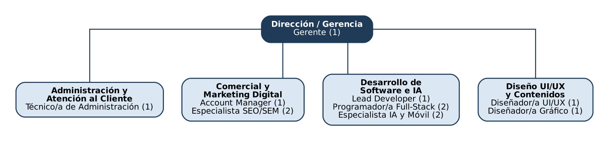

# 2. Departamentos y estructura organizativa

La empresa Appy Web cuenta con un equipo de 12 personas organizadas en 5 departamentos principales.

## Descripción de departamentos y puestos de trabajo

### 1. Dirección / Gerencia

- **Funciones y responsabilidades del departamento:** Dirigir la empresa y tomar las decisiones importantes. Fija los objetivos, aprueba los presupuestos e inversiones, coordina a los responsables de cada departamento y representa a AppyWeb ante clientes, bancos y otras empresas.
- **Número de trabajadores:** 1 persona.
- **Puestos de trabajo y funciones principales:**
  - **Gerente:** Planificar la estrategia de la empresa, controlar los resultados económicos, contratar personal y cerrar los acuerdos con los clientes más importantes.

### 2. Departamento de Administración y Atención al Cliente
- **Funciones y responsabilidades del departamento:** Garantizar el funcionamiento interno de la oficina, la contabilidad y el cumplimiento legal. También se encarga de tramitar subvenciones para los clientes y de actuar como primer filtro para atender incidencias o dudas iniciales.
- **Número de trabajadores:** 1 persona.
- **Puestos de trabajo y funciones principales:**
  - **Técnico/a de Administración:** Control de cobros y pagos, gestión de nóminas y contratos, atención telefónica primaria, y tramitación de documentación administrativa.

### 3. Departamento Comercial y Marketing Digital
- **Funciones y responsabilidades del departamento:** Es el motor de ingresos. Se encarga de captar nuevos clientes, cerrar ventas y proyectos, y de ejecutar los servicios de marketing digital (SEO/SEM) que la agencia vende a sus clientes.
- **Número de trabajadores:** 3 personas.
- **Puestos de trabajo y funciones principales:**
  - **Director/a de Cuentas / Account Manager (1):** Realizar auditorías a los potenciales clientes, elaborar y negociar presupuestos, y mantener la relación comercial y el seguimiento de los proyectos importantes.
  - **Especialista SEO/SEM y Marketing (2):** Diseñar, gestionar y analizar campañas publicitarias (Google Ads, redes sociales), posicionar las webs en los buscadores y redactar informes de resultados mensuales.

### 4. Departamento de Desarrollo de Software e IA
- **Funciones y responsabilidades del departamento:** Es el núcleo técnico de la empresa. Se encarga de construir los productos digitales vendidos y de desarrollar e implantar soluciones basadas en Inteligencia Artificial en los procesos de los clientes.
- **Número de trabajadores:** 5 personas.
- **Puestos de trabajo y funciones principales:**
  - **Lead Developer / Jefe/a de Proyectos (1):** Diseñar la arquitectura técnica de los proyectos, coordinar al equipo de programadores y asegurar que se cumplen los plazos de entrega.
  - **Programador/a Full-Stack (2):** Escribir el código para las páginas web y e-commerce, tanto de la parte visual (front-end) como de los servidores y bases de datos (back-end).
  - **Especialista en IA y Desarrollo Móvil (2):** Crear aplicaciones para iOS y Android, y conectar las plataformas de los clientes con APIs de Inteligencia Artificial (para crear asistentes virtuales o automatizar tareas).

### 5. Departamento de Diseño UI/UX y Contenidos
- **Funciones y responsabilidades del departamento:** Asegurar que todo el software desarrollado sea visualmente atractivo, intuitivo y ofrezca una excelente experiencia al usuario. También se encarga de dar soporte gráfico a las campañas de marketing.
- **Número de trabajadores:** 2 personas.
- **Puestos de trabajo y funciones principales:**
  - **Diseñador/a UI/UX Web y Apps:** Crear la estructura y el aspecto visual de las pantallas de las webs y aplicaciones, priorizando que sean fáciles de usar para el cliente final.
  - **Diseñador/a Gráfico y Multimedia:** Generar los recursos visuales, animaciones, logotipos y la identidad corporativa tanto para Appy Web como para sus clientes.

## Organigrama

