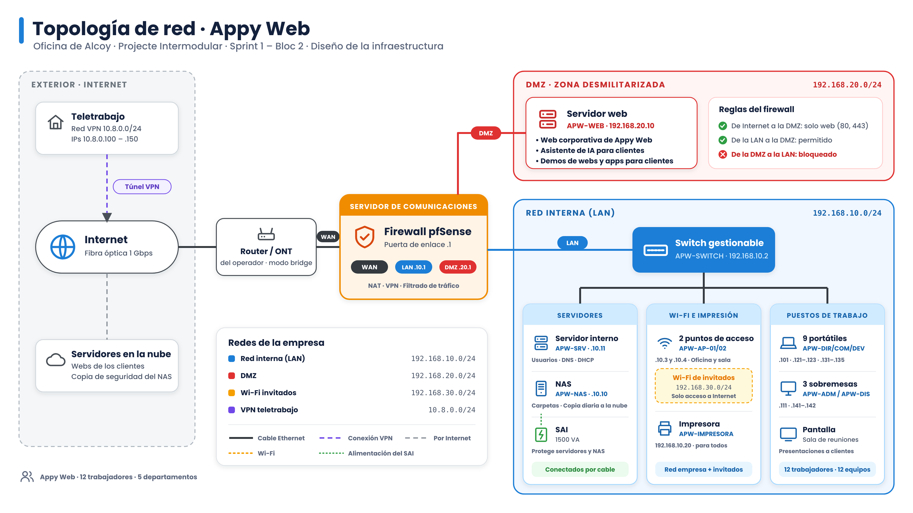

# 3. Diseño de la infraestructura y diagrama de red

En este apartado explicamos cómo será la red de la oficina de Appy Web en Alcoy. La hemos dividido en zonas para que, si alguien ataca lo que está expuesto a Internet, no pueda llegar a los ordenadores ni a los archivos de la empresa.

## Diagrama de red

## Zonas de la red

La red tiene tres zonas y todas pasan por el servidor de comunicaciones:

- WAN o Internet: es la conexión de fibra del operador.
- Red interna o LAN, 192.168.10.0/24: aquí están los ordenadores de los trabajadores, los servidores internos, el NAS y la impresora. Desde Internet no se puede entrar directamente.
- DMZ, 192.168.20.0/24: es una zona aparte donde ponemos lo que tiene que verse desde Internet.

Además, la Wi-Fi de invitados va en otra red separada, la 192.168.30.0/24, para que los clientes solo tengan Internet. Los trabajadores que se conectan desde fuera usan la red VPN 10.8.0.0/24. Todas las direcciones IP y los nombres de los equipos están en el apartado 4.

## Componentes y su función

| Componente | Función |
|---|---|
| Router/ONT del operador | Recibe la fibra. Lo dejamos en modo bridge para que quien controle la red sea nuestro servidor de comunicaciones. |
| Servidor de comunicaciones, firewall pfSense | Es el centro de la red y la puerta de enlace de todas las redes, con la dirección .1 en cada una. Tiene tres interfaces, WAN, LAN y DMZ, y decide qué tráfico puede pasar entre ellas. También hace NAT, da la VPN a los que teletrabajan y filtra las conexiones. |
| Servidor web APW-WEB, 192.168.20.10 | Está en la DMZ y aloja la web corporativa, el asistente de IA que responde a los clientes y las demos de las webs y apps que enseñamos a los clientes antes de publicarlas. |
| Switch gestionable APW-SWITCH, 192.168.10.2 | Tiene 24 puertos y conecta por cable todos los equipos de la red interna. Al ser gestionable permite crear VLAN, como la de invitados. |
| Servidor interno APW-SRV, 192.168.10.11 | Gestiona las cuentas de usuario, el DNS y el DHCP de la red interna. |
| NAS APW-NAS, 192.168.10.10 | Guarda los archivos compartidos de los departamentos y hace las copias de seguridad. Cada noche envía una copia cifrada a la nube, que es la solución híbrida que elegimos en el apartado 2. |
| Puntos de acceso APW-AP-01 y APW-AP-02, 192.168.10.3 y 192.168.10.4 | Son Wi-Fi 6 y dan Wi-Fi a la oficina y a la sala de reuniones. Emiten dos redes, la de la empresa y la de invitados. |
| Impresora APW-IMPRESORA, 192.168.10.20 | Impresora multifunción en red para toda la empresa. |
| SAI | Mantiene encendidos los servidores y el NAS si se va la luz, el tiempo justo para apagarlos bien. |
| Ordenadores | 3 sobremesas de Administración y Diseño conectados por cable y 9 portátiles con dock para Dirección, Comercial y Desarrollo. Cada departamento tiene su propio bloque de IPs a partir de la 192.168.10.101. |

## Conexiones

- La fibra llega al router del operador y de ahí va al puerto WAN del servidor de comunicaciones.
- El puerto DMZ del servidor de comunicaciones va directo al servidor web.
- El puerto LAN va al switch, y del switch salen los cables a todos los equipos de la oficina y a los dos puntos de acceso.
- Los trabajadores que están fuera se conectan por VPN a través de Internet. Reciben una IP de la red 10.8.0.0/24 y entran a la red interna como si estuvieran en la oficina.
- Las webs y apps de los clientes que ya están publicadas siguen en los servidores en la nube, como dijimos en el Bloc 1.
- El NAS sale a Internet a través del firewall para enviar cada noche la copia de seguridad a la nube. Así, si hay un incendio, un robo o un ataque de ransomware en la oficina, los datos siguen a salvo fuera.

## Decisiones técnicas

- Usamos un firewall con tres interfaces en lugar del router del operador, porque un router normal no permite crear una DMZ de verdad ni configurar bien la VPN.
- Ponemos la DMZ en una red distinta, la 192.168.20.0/24. Así, si atacan el servidor web, el atacante no está dentro de nuestra red interna.
- Conectamos por cable los equipos que más datos mueven, que son los de Diseño, los portátiles de Desarrollo con su dock, el NAS y los servidores, porque el cable es más rápido y estable que la Wi-Fi.
- Separamos la Wi-Fi de invitados en la red 192.168.30.0/24, porque los clientes que vienen a la oficina no tienen que poder ver nuestros archivos.

## Qué servicios van en la DMZ y por qué

- Web corporativa: la tiene que poder ver cualquiera desde Internet.
- Asistente de IA para clientes: es un chat en la web corporativa que responde las dudas más habituales. Solo usa información pública de la empresa como los servicios, los precios orientativos y las preguntas frecuentes, que está guardada en el propio servidor de la DMZ. Nunca accede a los datos internos de la LAN.
- Entorno de demos para clientes: los clientes entran desde su casa para ver cómo va su web o app.

Los ponemos en la DMZ porque son servicios accesibles desde Internet y por eso son los más expuestos a ataques. El firewall deja que desde Internet se llegue a la DMZ solo por los puertos 80 y 443, pero no deja que desde la DMZ se entre a la red interna. Los archivos, las cuentas de usuario y los datos de los clientes se quedan siempre en la LAN.

## Fuentes técnicas consultadas

- Documentación oficial de pfSense: https://docs.netgate.com/pfsense/en/latest/
- INCIBE, ciberseguridad para empresas: https://www.incibe.es/empresas
- Apuntes de los módulos de Serveis en Xarxa y Seguretat Informàtica de 2º SMX.